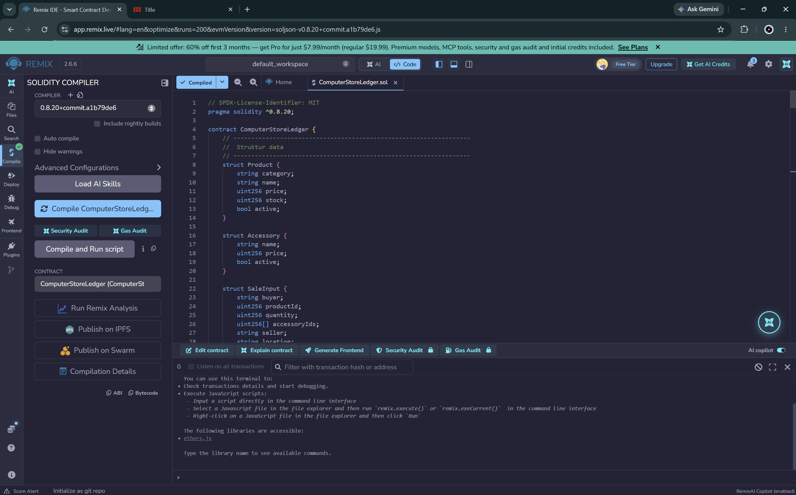

# Laporan Analisis Smart Contract: `ComputerStoreLedger`

| Item | Keterangan |
|---|---|
| **File** | `ComputerStoreLedger.sol` |
| **Lisensi** | MIT |
| **Versi Solidity** | `^0.8.20` |
| **Jumlah baris** | ± 405 |
| **Target deploy** | Remix IDE / jaringan EVM (Ethereum & sejenisnya) |
| **Tujuan** | Buku besar (ledger) penjualan toko komputer berbasis rantai blok, hasil porting dari `databasecore.py` (Python) |

---

## 1. Ringkasan Eksekutif

`ComputerStoreLedger` adalah kontrak pintar yang mencatat transaksi penjualan toko komputer sebagai **rantai blok internal** (setiap penjualan = satu blok yang di-hash dan ditautkan ke blok sebelumnya). Kontrak juga mengelola **katalog produk**, **aksesori**, dan **stok**, serta menyediakan **verifikasi integritas rantai** dan **simulasi serangan (tamper)** untuk keperluan edukasi.

**Kesimpulan singkat**

- Cocok sebagai **proyek edukasi / prototipe / demo** konsep blockchain ledger.
- **Belum layak untuk produksi** tanpa perbaikan, terutama: fitur `tamperBlockForDemo`, data pembeli yang tersimpan publik, dan celah hak akses pada `transferOwnership` (lihat Bagian 7).

---

## 2. Pemetaan dari Versi Python

| Python (`databasecore.py`) | Solidity |
|---|---|
| `Block` | `struct LedgerBlock` |
| `Blockchain` | `contract ComputerStoreLedger` |
| `create_genesis` | `constructor()` |
| `add_block()` | `recordSale()` |
| `tamper_block()` | `tamperBlockForDemo()` *(hanya demo)* |
| `is_chain_valid()` | `isChainValid()` / `verifyChain()` |
| `stok_produk` | `products[id].stock` |
| SHA-256 | `keccak256` |
| Proof of Work (nonce/difficulty) | **Dihilangkan**, konsensus ditangani jaringan Ethereum |

---

## 3. Struktur Data

| Struct | Field | Fungsi |
|---|---|---|
| `Product` | `category`, `name`, `price`, `stock`, `active` | Data produk (harga dalam Rupiah, bilangan bulat) |
| `Accessory` | `name`, `price`, `active` | Data aksesori tambahan |
| `SaleInput` | `buyer`, `productId`, `quantity`, `accessoryIds[]`, `seller`, `location` | Parameter input `recordSale` |
| `Sale` | `buyer`, `productId`, `productName`, `quantity`, `accessories`, `total`, `seller`, `stockBefore`, `stockAfter`, `location` | Data transaksi yang disimpan dalam blok |
| `LedgerBlock` | `index`, `timestamp`, `sale`, `prevHash`, `hash` | Satu blok dalam ledger |

### State Variable

| Variabel | Tipe | Visibilitas | Keterangan |
|---|---|---|---|
| `owner` | `address` | public | Pemilik kontrak |
| `isStaff` | `mapping(address => bool)` | public | Daftar kasir/admin |
| `chain` | `LedgerBlock[]` | **private** | Rantai blok (diakses via fungsi getter) |
| `products` / `productCount` | mapping / `uint256` | public | Katalog produk (ID mulai dari 1) |
| `accessories` / `accessoryCount` | mapping / `uint256` | public | Katalog aksesori (ID mulai dari 1) |
| `demoTamperEnabled` | `bool` | public | Saklar fitur tamper (default `true`) |
| `sampleSeeded` | `bool` | public | Penanda data contoh sudah diisi |

---

## 4. Kontrol Akses

| Modifier | Syarat | Pesan error |
|---|---|---|
| `onlyOwner` | `msg.sender == owner` | `"Hanya owner"` |
| `onlyStaff` | owner **atau** `isStaff[msg.sender]` | `"Hanya owner/staff"` |

### Matriks Hak Akses Fungsi

| Fungsi | Publik | Staff | Owner |
|---|:-:|:-:|:-:|
| `recordSale` | | ✅ | ✅ |
| `restock` | | ✅ | ✅ |
| `setStaff` | | | ✅ |
| `transferOwnership` | | | ✅ |
| `addProduct` / `addAccessory` | | | ✅ |
| `setProductPrice` / `setProductActive` | | | ✅ |
| `seedSampleCatalog` | | | ✅ |
| `tamperBlockForDemo` / `disableDemoTamper` | | | ✅ |
| `verifyChain`, `isChainValid`, `getBlock`, `getLatestBlock`, `getChainLength`, `calculateHash`, `getStock`, `previewTotal` | ✅ | ✅ | ✅ |

---

## 5. Daftar Fungsi

### 5.1 Administrasi

| Fungsi | Deskripsi |
|---|---|
| `constructor()` | Menetapkan deployer sebagai owner & staff, lalu membuat **Genesis Block** (index 1, `prevHash = 0x0`) |
| `setStaff(address, bool)` | Menambah/mencabut hak staff |
| `transferOwnership(address)` | Mengalihkan kepemilikan (tidak boleh ke `address(0)`) |
| `addProduct(category, name, price, stock)` | Menambah produk; `name` tidak boleh kosong, `price > 0` |
| `addAccessory(name, price)` | Menambah aksesori; validasi sama seperti produk |
| `restock(productId, amount)` | Menambah stok; `amount > 0` |
| `setProductPrice(productId, newPrice)` | Mengubah harga produk |
| `setProductActive(productId, active)` | Mengaktifkan/menonaktifkan produk |
| `seedSampleCatalog()` | Mengisi 6 produk & 5 aksesori contoh (sekali saja) |

**Katalog contoh (`seedSampleCatalog`)**

| ID | Kategori | Produk | Harga (Rp) | Stok |
|:-:|---|---|--:|--:|
| 1 | Motherboard | AMD AM4 - B550 | 1.750.000 | 10 |
| 2 | CPU | AMD Ryzen 5 5600 | 1.850.000 | 10 |
| 3 | RAM | DDR4 16GB | 650.000 | 20 |
| 4 | GPU | NVIDIA RTX 4060 (40 Series) | 5.200.000 | 5 |
| 5 | PSU | 650W 80+ Bronze | 950.000 | 8 |
| 6 | Storage | SSD NVMe Gen4 2TB | 2.250.000 | 6 |

| ID | Aksesori | Harga (Rp) |
|:-:|---|--:|
| 1 | Kabel HDMI | 100.000 |
| 2 | Mousepad | 75.000 |
| 3 | Flashdisk 64GB | 90.000 |
| 4 | Thermal Paste | 75.000 |
| 5 | Kabel Power | 50.000 |

### 5.2 Transaksi: `recordSale(SaleInput)`

**Validasi:**

1. `buyer`, `seller`, `location` tidak boleh kosong
2. `quantity > 0`
3. Produk valid, **aktif**, dan `quantity <= stock`
4. Semua `accessoryIds` valid dan aktif

**Alur proses:**

```
Staff memanggil recordSale
        │
        ▼
  Validasi input & stok
        │
        ▼
  Hitung aksesori (_accessoryInfo) → total + daftar nama
        │
        ▼
  Kurangi stok  (stockBefore → stockAfter)
        │
        ▼
  total = (harga produk + total aksesori) × quantity
        │
        ▼
  _appendBlock: ambil prevHash → hitung keccak256 → push blok → emit BlockAdded
        │
        ▼
  Return blockIndex
```

**Contoh input di Remix:**

```
["Budi", 1, 2, [1,2], "Admin Andi", "Cirebon"]
```

Hasil (setelah `seedSampleCatalog`): total = (1.750.000 + 100.000 + 75.000) × 2 = **Rp 3.850.000**, stok produk 1 turun dari 10 menjadi 8.

### 5.3 Validasi Rantai: `verifyChain()`

Untuk setiap blok, fungsi memeriksa dua hal:

1. **Hash tersimpan** harus sama dengan hash hasil hitung ulang dari `index, timestamp, sale, prevHash`.
2. **Pointer `prevHash`**: blok pertama harus `0x0`, blok lainnya harus sama dengan `hash` blok sebelumnya.

Mengembalikan `(valid, firstInvalidIndex)`. Nilai `0` berarti rantai valid.

### 5.4 Simulasi Serangan

| Fungsi | Deskripsi |
|---|---|
| `tamperBlockForDemo(index, newBuyer)` | Mengubah `buyer` pada blok tanpa menghitung ulang hash → `verifyChain()` akan mendeteksi. Genesis (index 1) tidak bisa dirusak. |
| `disableDemoTamper()` | Mematikan fitur tamper **secara permanen** |

### 5.5 Fungsi Baca

`getChainLength`, `getBlock(index)`, `getLatestBlock`, `calculateHash(index)`, `getStock`, `previewTotal(productId, quantity, accessoryIds)`. Indeks blok dimulai dari **1**, sama seperti versi Python.

### 5.6 Event

`BlockAdded`, `ProductAdded`, `AccessoryAdded`, `Restocked`, `StaffUpdated`, `OwnershipTransferred`, `BlockTampered`.

> Perubahan harga (`setProductPrice`) dan status aktif (`setProductActive`) **tidak** memancarkan event.

---

## 6. Mekanisme Hash

```solidity
keccak256(abi.encode(index, timestamp, sale, prevHash))
```

- Seluruh isi `Sale` (termasuk string) ikut di-hash, sehingga perubahan satu karakter pada data transaksi mengubah hash.
- `abi.encode` (bukan `encodePacked`) dipakai sehingga **aman dari collision** antar string dinamis.
- Karena `prevHash` ikut di-hash, perubahan satu blok akan memutus tautan ke seluruh blok sesudahnya.

---

## 7. Temuan & Rekomendasi

### Tingkat Keparahan

| # | Temuan | Tingkat |
|:-:|---|:-:|
| 1 | `tamperBlockForDemo` memungkinkan owner mengubah catatan historis | 🔴 Tinggi (jika produksi) |
| 2 | Data pembeli tersimpan **publik** di blockchain | 🔴 Tinggi |
| 3 | Owner lama tetap menjadi staff setelah `transferOwnership` | 🟠 Sedang |
| 4 | Tidak ada mekanisme pembatalan/refund transaksi | 🟠 Sedang |
| 5 | Perubahan stok (restock) & harga tidak tercatat di rantai | 🟡 Rendah–Sedang |
| 6 | `verifyChain` berbiaya O(n), berisiko gagal pada rantai panjang | 🟡 Rendah–Sedang |
| 7 | Field `Accessory.active` tidak dapat diubah (kode mati) | 🟡 Rendah |
| 8 | `previewTotal` tidak memvalidasi `quantity`, status aktif, atau stok | 🟡 Rendah |
| 9 | Aksesori yang sama dapat dimasukkan berulang | 🟡 Rendah |
| 10 | Transfer kepemilikan satu langkah (risiko salah alamat) | 🟡 Rendah |
| 11 | Event tidak lengkap untuk perubahan harga/status | ⚪ Informasional |
| 12 | Hash chain redundan di atas Ethereum | ⚪ Informasional |

### Detail

**1. Fungsi tamper merusak sifat immutability.**
Pada blockchain sungguhan data lama tidak dapat diubah, namun fungsi ini membuka celah bagi owner. Default `demoTamperEnabled = true`. *Rekomendasi:* hapus fungsi dari versi produksi, atau jadikan `immutable` flag yang ditetapkan saat deploy (misalnya lewat constructor), bukan saklar yang bergantung pada pemanggilan manual.

**2. Privasi data.** Modifier `private` pada `chain` hanya membatasi akses antar-kontrak. Isi storage tetap dapat dibaca siapa saja, dan `getBlock` bersifat `external view` publik. Nama pembeli, lokasi, dan nama penjual terekspos permanen. Ini berpotensi bertentangan dengan UU Pelindungan Data Pribadi (UU PDP). *Rekomendasi:* simpan hanya hash/identifier pseudonim on-chain, dan data pribadi di basis data off-chain.

**3. Hak staff tidak dicabut saat transfer kepemilikan.** `transferOwnership` memberi `isStaff[newOwner] = true`, tetapi `isStaff[oldOwner]` tetap `true`. *Rekomendasi:* cabut hak staff owner lama, dan pertimbangkan pola dua langkah (`proposeOwner` → `acceptOwnership`) atau `Ownable2Step` dari OpenZeppelin.

**4. Tidak ada pembatalan transaksi.** Salah input hanya bisa dikoreksi dengan menambah transaksi baru, namun tidak ada fungsi retur yang mengembalikan stok. *Rekomendasi:* tambah fungsi `recordRefund` yang menambah blok koreksi dan mengembalikan stok.

**5. Stok dapat berubah di luar rantai.** `restock` dan `setProductPrice` mengubah state tanpa blok. `verifyChain` hanya memeriksa konsistensi hash dan **tidak** memeriksa kesesuaian `stockBefore/stockAfter` dengan stok aktual. *Rekomendasi:* catat restock sebagai blok, atau minimal pastikan event selalu dipancarkan untuk audit.

**6. Biaya iterasi.** `verifyChain` membaca seluruh storage secara berulang. Aman untuk panggilan `eth_call` skala kecil, tetapi dapat melewati batas gas pada rantai besar atau jika dipanggil dari kontrak lain. *Rekomendasi:* tambah versi berhalaman, misalnya `verifyRange(from, to)`.

**7. Kode mati pada aksesori.** Aksesori tidak punya fungsi untuk menonaktifkan atau mengubah harga, sehingga pengecekan `a.active` tidak pernah bernilai `false`. *Rekomendasi:* tambah `setAccessoryActive` dan `setAccessoryPrice`.

**8. `previewTotal` kurang validasi.** Hasil preview bisa menunjukkan total untuk produk nonaktif atau jumlah melebihi stok, padahal `recordSale` akan menolak. *Rekomendasi:* samakan validasi dengan `recordSale`.

**9. Duplikasi aksesori.** `[1,1,1]` dihitung tiga kali. Jika tidak disengaja, tambahkan pengecekan duplikat; jika disengaja, gunakan field jumlah per aksesori.

**10–11.** Tambahkan event `ProductPriceChanged` dan `ProductActiveChanged` untuk transparansi perubahan.

**12. Redundansi.** Di atas Ethereum, riwayat transaksi sudah immutable lewat konsensus, sehingga hash chain internal berfungsi terutama sebagai **alat edukasi** dan alat deteksi manipulasi bila fungsi tamper aktif.

---

## 8. Hal yang Sudah Baik

- ✅ Memakai Solidity ≥ 0.8, sehingga **overflow/underflow otomatis ditolak**
- ✅ Pola **checks-effects** yang rapi; tidak ada pemanggilan eksternal atau transfer ETH, jadi **tidak ada risiko reentrancy**
- ✅ Pesan error jelas dan validasi input memadai
- ✅ `abi.encode` menghindari ambiguitas hash
- ✅ Pembungkusan input dalam `SaleInput` mengurangi risiko *stack too deep*
- ✅ Dokumentasi NatSpec dan komentar pemetaan dari Python sangat membantu
- ✅ Ada saklar `disableDemoTamper` dan Genesis Block dilindungi dari tamper

---

## 9. Skenario Pengujian di Remix

| Langkah | Aksi | Hasil yang diharapkan |
|:-:|---|---|
| 1 | Deploy kontrak | Genesis Block terbentuk, `getChainLength() = 1` |
| 2 | `seedSampleCatalog()` | 6 produk & 5 aksesori terisi |
| 3 | `previewTotal(1, 2, [1,2])` | `3850000` |
| 4 | `recordSale(["Budi",1,2,[1,2],"Admin Andi","Cirebon"])` | Mengembalikan `2`, `getStock(1) = 8` |
| 5 | `isChainValid()` | `true` |
| 6 | `tamperBlockForDemo(2, "Hacker")` | Event `BlockTampered(2)` |
| 7 | `verifyChain()` | `(false, 2)` |
| 8 | `recordSale(...)` dengan `quantity` > stok | Revert `"Stok tidak cukup"` |
| 9 | Panggil `recordSale` dari akun non-staff | Revert `"Hanya owner/staff"` |
| 10 | `disableDemoTamper()` lalu `tamperBlockForDemo` | Revert `"Mode demo dimatikan"` |

> **Catatan:** Setelah langkah 6, rantai tetap rusak karena tidak ada fungsi perbaikan. Deploy ulang kontrak untuk mengulang demo.

---

## 10. Kesimpulan

Kontrak ini berhasil menerjemahkan konsep blockchain sederhana dari Python ke Solidity dengan struktur kode yang bersih dan aman dari kerentanan klasik (overflow, reentrancy). Sebagai **materi pembelajaran dan prototipe**, kualitasnya baik. Untuk **penggunaan produksi**, prioritas perbaikan adalah:

1. Menghapus/mengunci permanen fitur tamper
2. Tidak menyimpan data pribadi secara publik
3. Memperbaiki pencabutan hak staff pada transfer kepemilikan
4. Menambah fitur refund dan pencatatan restock/harga
5. Menambah pengujian otomatis (Foundry/Hardhat) dan audit independen sebelum deploy ke jaringan utama

---

Laporan Keberhasilan

