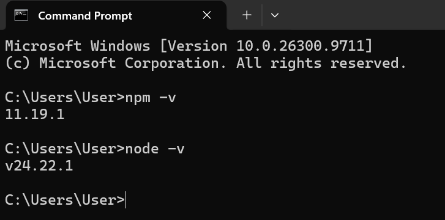

# INTEGRASI FRONT END DAN WEB3 #

## Langkah Praktikum ##

1. Cek Instalasi Node dan NPM (node -v, npm -v)
2. Jika belum tersedia instal via https://nodejs.org/en/download
3. bukti node Js dan NPM

4. Buat folder baru nama dApps
5. Open Terminal dan CD ke dalam folder tersebut
   '''Bash
   mkdir dApps
   cd pertemuan_9/dApps
6. Inisiasi 
npm init -y
7. Install framwork hardhat
npm install --save-dev hardhat

8. Menjalankan Hardhat (npx hardhat --init )
